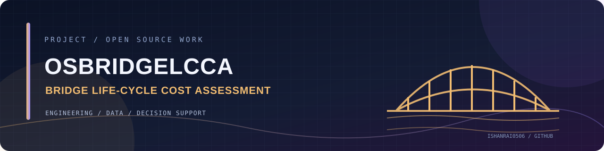

<!-- PROJECT BANNER -->
<div align="center">



# OsBridgeLCCA

### Open-source bridge life-cycle cost assessment

OsBridgeLCCA is an open-source engineering application for evaluating bridge life-cycle costs. It brings together cost estimation, traffic analysis, emissions calculations, visualisation and financial assessment to support infrastructure decisions.

<p>
  
  
</p>

</div>

---

## ✨ What it does

<div>

**01 / Life-cycle cost analysis**  
Estimate costs across a bridge's lifespan.

</div>
<div>

**02 / Traffic analysis**  
Assess traffic-related impacts and cost implications.

</div>
<div>

**03 / Emissions estimation**  
Evaluate environmental impact.

</div>
<div>

**04 / Visualisation**  
Explore results with Plotly and Matplotlib.

</div>
<div>

**05 / Report generation**  
Export PDF, Excel and LaTeX reports.

</div>
<div>

**06 / Multiple interfaces**  
Includes PyQt desktop and React web interfaces.

</div>

## 🧰 Tech stack

Python · Django · Django REST Framework · PyQt5 · React · Plotly · Matplotlib · PyLaTeX · pytest · Docker

## 🚀 Getting started

### Prerequisites

Python and the project dependencies are required.

### Installation

```bash
git clone https://github.com/IshanRai0506/OsBridgeLCCAcustom.git
cd OsBridgeLCCAcustom
# Recommended: create and activate a Conda environment
# Then follow the platform-specific setup script:
# Linux / macOS
bash install.sh
# Windows
install.bat
```


## 📝 Notes

The repository README describes both desktop and web entry points. Follow the project's current install scripts and verify the environment before launching either interface.


## 🤝 Contributing

Ideas, bug reports and thoughtful improvements are welcome. Open an issue to discuss a change before submitting a pull request.

## 👨‍💻 Maintainer

**Ishan Rai** · [GitHub](https://github.com/IshanRai0506) · [LinkedIn](https://linkedin.com/in/ishanrai-tech)

---

<div align="center">

*Built with curiosity. Improved one commit at a time.* ✨

</div>
